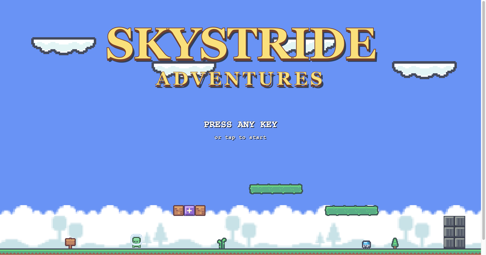
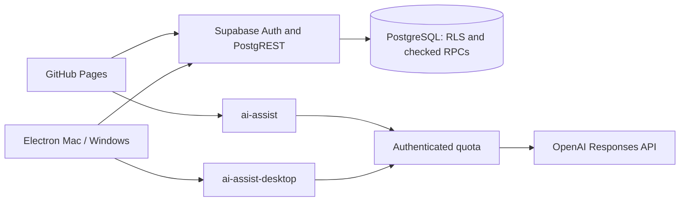

# SkyStride Adventures

A retro 2D platformer with six official courses, a Course Maker, community levels, cloud progress, and AI gameplay hints. Built for desktop with **Phaser 3, TypeScript, Vite, Supabase, and Electron**.

**[Play in your browser](https://drat-git.github.io/skystride-adventures/)** · **[Download the desktop apps](https://github.com/drat-git/skystride-adventures/releases/tag/v0.2.0)** · **[Documentation](docs/README.md)**



## Play or download

| Version | Get it | Status |
| --- | --- | --- |
| Web | [GitHub Pages game](https://drat-git.github.io/skystride-adventures/) | Hosted game; no installation |
| Mac — Apple Silicon | [Download Mac ZIP](https://github.com/drat-git/skystride-adventures/releases/download/v0.2.0/SkyStride-Adventures-mac-arm64.zip) | Verified packaged app; M-series Macs only |
| Windows — 64-bit | [Download Windows ZIP](https://github.com/drat-git/skystride-adventures/releases/download/v0.2.0/SkyStride-Adventures-windows-x64.zip) | Untested, unsigned backup build |

**Mac:** extract the ZIP, copy **SkyStride Adventures.app** to Applications or another local folder, and open it. The app is ad-hoc signed and not Apple-notarized; another Mac may require approval in macOS security settings. See the [Mac guide](docs/MAC_APP.md).

**Windows:** extract the **entire ZIP**, open the **SkyStride Adventures** folder, and run **SkyStride Adventures.exe**. Keep all included files and folders together. This portable build has no installer and may show an unknown-publisher warning. It was cross-built on a Mac and has not been run or tested on Windows. See the [Windows guide](docs/WINDOWS_APP.md).

The desktop apps need no Node, npm, development server, or separate browser. Sign in with the same account on any version to access the same hosted data. Sessions and device settings are separate for each app/browser. Internet is required for accounts, cloud saves, community features, rankings, achievements, and AI. The desktop apps bundle all six official courses for offline guest play; offline runs are not uploaded later.

Download archives and SHA-256 checksums live in **[GitHub Releases](https://github.com/drat-git/skystride-adventures/releases)**, keeping large binaries out of the source repository. [Installation, checksums, and release details](docs/RELEASES.md).

## Features

- **Six official courses:** two meadow, two cave, and two sky stages with scrolling cameras, checkpoints, collectibles, hazards, moving platforms, and ground/flying enemies.
- **Platforming and power-ups:** variable-height jumps, stomps, shell chains, breakable bricks, glowing/hidden blocks, growth, fire projectiles, and temporary star protection. Unlimited retries.
- **Complete game menus:** animated title, pause/resume, checkpoint retry, restart, next course, replay, level list, and main menu. Gameplay-only fullscreen persists through restart and next-course transitions; returning to menus exits it.
- **Course Maker:** all three themes and the game's supported components, keyboard grid navigation, inspection, unsaved preview, reliable private draft saving, and revision-conflict recovery.
- **Tested publication:** save, complete the exact saved revision, then publish. Published courses are immutable; copy one into a new private draft to make changes.
- **Community:** course details, 1–5 ratings with replacement/removal, independent favorites, shared totals, deterministic sorting, and My Favorites. A recorded account play attempt unlocks interactions; finishing is optional.
- **Progress and competition:** saved fastest completions, time/score leaderboards with shared ranks and a top-50 limit, three general achievements, and three challenges for each official course. Earned achievement icons are green; locked icons are faded red.
- **AI assistance:** context-specific hints while paused and feedback on the current unsaved draft. Advice never edits a course or grants publication approval.
- **Settings:** device-local reduced motion and sound controls, without changing physics, collisions, or timing.

## Controls

| Action | Input |
| --- | --- |
| Enter the main menu | Any key or click on the title |
| Move | Left/Right arrows or A/D |
| Jump | Space, Up arrow, or W; hold for a higher jump |
| Fire projectile while powered up | X or J |
| Pause / resume | Escape or the visible pause controls |
| Fullscreen | Gameplay's fullscreen control; use its Exit action or return to a menu to leave |

Typing in form fields does not control the player. Switching tabs pauses gameplay; use Resume when returning. Coins survive checkpoint retries and reset on a fresh run. Courses currently start with a 150-second limit. Elapsed time, time remaining, score, coins, and saved fastest completion are shown during play.

## Accounts and course creation

Guests can play the official courses and try the editor locally. Create an account to persist progress, save courses, publish, interact with community courses, or use AI. Email confirmation is disabled. New passwords require **8–128 characters**, including an uppercase letter, a lowercase letter, a number, and an ASCII punctuation symbol such as `!`, `@`, or `#`.

To publish a course:

1. Create and save a private draft in **Course Maker**.
2. Select **Test saved version** and reach the finish.
3. Wait for the backend to confirm that saved revision's successful playtest.
4. Select **Publish**. Another player can now discover and play it.

**Preview draft** runs current unsaved work and does not qualify it for publication. Any edit requires saving and retesting. Failed saves retain local edits; conflicting browser tabs can reload or save a separate copy. Drafts and individual interaction records are private to their owners.

## Run from source

Use **Node 24** and npm:

```sh
git clone https://github.com/drat-git/skystride-adventures.git
cd skystride-adventures
npm ci
npm run dev
```

Open **http://127.0.0.1:5186**. The launcher also starts an isolated local API on port **5187**. No production credentials are needed. It runs the actual SQL migrations and row-level policies in PGlite, with separate development Auth/REST fixtures. Local accounts cannot sign in to the hosted game. Data stays under ignored `output/overhaul/local-db/`.

The local launcher overrides inherited backend configuration without editing `.env.local` or contacting production. Local AI shows an unavailable explanation instead of calling a paid provider. See [local development and isolation](docs/LOCAL_DEVELOPMENT.md).

## Build and verification

| Command | Purpose |
| --- | --- |
| `npm run dev` | Isolated local game and API |
| `npm test` | Domain, SQL, security, persistence, and AI-contract tests |
| `npm run typecheck` | TypeScript checking |
| `npm run build` | Type-check and build the web app into `dist/` |
| `npm run build:mac` | On macOS, build the Apple Silicon app and ZIP under `output/mac/` |
| `npm run build:windows` | On macOS, cross-package the Windows x64 backup under `output/windows/`; no tests/type checking |

Desktop packaging needs the production `VITE_SUPABASE_URL` and **public** `VITE_SUPABASE_PUBLISHABLE_KEY` in private `.env.local`. See [.env.example](.env.example). Never put a Supabase service-role key or OpenAI key in frontend environment variables.

Browser checks are opt-in: `npm run test:browser`, `test:editor`, `test:runtime`, `test:courses:ground`, `test:courses:sky`, `test:courses:final`, `test:production`, and `test:title`. The scripts document their fixture requirements. Playwright/Chromium can be supplied with `PLAYWRIGHT_MODULE` and `CHROME_PATH`; they are not bundled with the game. Hosted tests use dedicated disposable accounts and real services, and must be run deliberately. [Verification record and limitations](docs/OVERHAUL_VERIFICATION.md).

The latest recorded Mac milestone passed **297 automated checks across 18 files**, TypeScript, production compilation, and **six packaged-app acceptance groups**, including real Auth, saved drafts/playtests/publication, community persistence, real AI, fullscreen, and offline guest play. All six official courses have separately been completed with keyboard input. **The Windows backup has no runtime test coverage.** These are recorded results, not tests rerun for a documentation update.

## Architecture



The web and desktop versions share the game source and cloud data. Separate Vite configurations preserve the existing web URL and route desktop AI to its own origin-restricted endpoint. Desktop renderer Node access is disabled; context isolation, sandboxing, web security, and a restrictive content-security policy are enabled. [Architecture and source map](docs/ARCHITECTURE.md).

The database has eight public application tables plus private AI quota counters. Courses use the validated V2 JSON format; active V1 courses and frontend support have been retired. Historical migrations and upgrade fixtures remain to reproduce upgrades. Apply only missing migrations to an existing project; never rerun initial schema/seed scripts against existing data. [Database dictionary](docs/DATABASE.md) · [AI configuration](docs/AI.md).

The existing Pages workflow builds and deploys pushes to `main`. Desktop packaging and GitHub release assets are separate from that deployment. Installed apps use their bundled frontend; distribute a new app build to update them.

## Documentation and credits

Start with the [documentation index](docs/README.md), [release guide](docs/RELEASES.md), and [changelog](CHANGELOG.md). Earlier sprint verification and requirement checklists are historical records; the class report and presentation are maintained separately.

Astro Hop by Nuno Amorim supplies MIT-licensed reference code and the source layouts for the first four courses. Kenney Pixel Platformer supplies CC0 art. The two sky courses adapt the route and encounters of New Super Mario Bros. DS World 7-6 with an original sky pack; no Nintendo artwork is shipped. The sky track **Skyward Steps** is an original synthesized composition. See [asset attribution and included licenses](public/assets/astrohop/ATTRIBUTION.md) and [course provenance](docs/OVERHAUL.md#reference-fidelity-and-course-provenance). Electron/Chromium notices are included in each desktop archive.

This is a software engineering class project focused on desktop use. Completion/results are client-reported within that trust model; saved-version publication checks are not production anti-cheat. AI advice can be wrong and is not a solvability proof.
